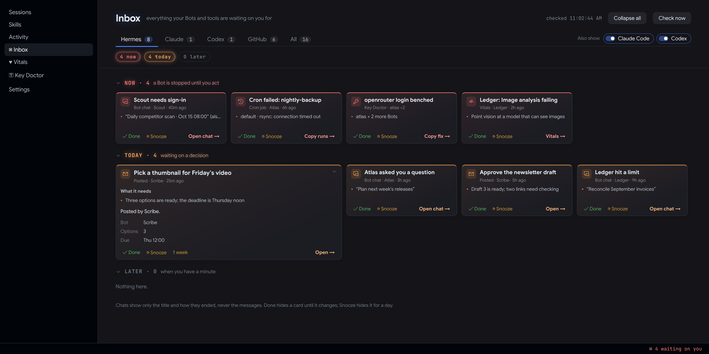
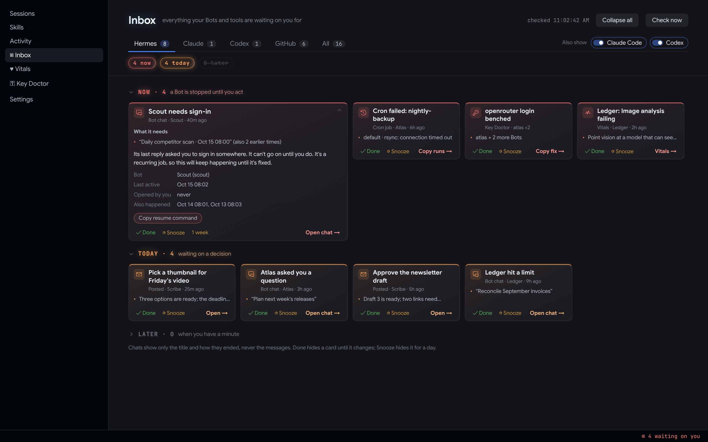

# Hermes Agent Inbox

**Everything your Hermes Bots and tools are waiting on you for, in one list.**



You run several Bots, cron jobs and background tasks. When one of them needs you, the signal is scattered:
- a session that ended on "please sign in";
- a cron job that failed overnight;
- a login Hermes quietly benched;
- a PR that's been ready for a week.

The Inbox collects all of it into Now / Today / Later cards in Hermes Desktop, plus `hermes inbox` in the terminal and `/inbox` in any chat.

Bots can post their own cards too (`hermes inbox add`), so a cron job can ask you for a decision without spamming your phone.

## What shows up

| Source | A card appears when | Priority |
|---|---|---|
| **Chats** | A Bot's session in the last 48 h ended on a sign-in or an approval request | Now |
| | It hit a limit, a missing tool or a site that refused it | Today |
| | It ended on a question you haven't opened | Today |
| **Crons** | A job's last run failed | Now |
| **Keys** ([Key Doctor](https://github.com/BkashJEE/hermes-key-doctor), optional) | A Bot can't reach its model; a login is benched, dead or expiring | Now / Today |
| **Vitals** (optional) | A red alarm | Now |
| **PRs** (`gh`, optional) | Your PR is ready to merge | Today, or Later if untouched for 30 days |
| | Your PR has conflicts or failing checks | Later |
| **Posted** | A Bot or script ran `hermes inbox add` | its choice |
| **X Studio** (optional) | A draft is waiting for review | Today |

Chats show only the session title and how the session ended, never the messages. A daily cron that gets stuck every day shows as **one** card ("also 2 earlier times").

## In Hermes Desktop

- **The Inbox page** (`/inbox`, sidebar and ⌘K).
- **Flash cards** grouped Now / Today / Later.
- **Folding:** each section folds, and the fold is remembered.
- **Click a card to expand it.** You see:
  - why it's there;
  - the facts (when, how often, which Bot);
  - the exact command;
  - one-click copy buttons.
- **Open chat →** jumps straight to the stuck session in the right Bot.
- **Done** hides a card until it changes. **Snooze** hides it for a day; expanded cards also offer a week.
- **A `▣` status-bar chip:** `2 waiting on you`.



*Screenshots use sample data (`harness/demo.json`).*

## Bots can ask you for things

```bash
hermes inbox add "Pick a thumbnail for Friday's video" \
  --from Gary --priority today --url https://example.com/thumbs --key friday-thumb
```

- **`--key`:** the same key updates the card instead of adding a duplicate, so a cron can re-post safely.
- **`--hours N`:** the card expires after N hours.
- **`--session ID --profile NAME`:** the card opens that chat.

The plugin ships an `inbox` skill that teaches Bots when to post (and when not to).

## Install

```bash
hermes plugins install BkashJEE/hermes-agent-inbox --enable
```

Then switch it on in **Hermes Desktop → Settings → Plugins**. Desktop starts agent + desktop packages switched off.

### Use it

```bash
hermes inbox                       # the list
hermes inbox --source crons        # one source
hermes inbox --json                # for tools
hermes inbox done ID               # hide until it changes
hermes inbox snooze ID 24          # hide for 24 h
hermes inbox add "Title" [...]     # post a card
```

## Settings (optional)

`~/.hermes/inbox.json`:

```json
{
  "sources": { "prs": false },
  "ignore_repos": ["me/old-experiment"],
  "stale_pr_days": 30,
  "xstudio_url": "http://127.0.0.1:3417"
}
```

## What it reads and writes

- **Reads:**
  - each profile's `state.db`: session titles, timestamps, and the last assistant reply, which is used only to tell how the session ended;
  - `cron/jobs.json`;
  - Key Doctor's and Vitals' JSON output, if those plugins are installed;
  - `gh search prs --author @me`, if `gh` is signed in;
  - the X Studio URL, if you set one.
- **Writes:**
  - `~/.local/state/hermes-inbox/`: done/snooze marks and a 10-minute PR cache;
  - `~/.hermes/inbox/`: posted cards.
- **Never:** it doesn't send anything anywhere, and it doesn't read tokens.

Each source fails soft. If one can't be read, the others still show, with a one-line note.

## Develop

```bash
python3 -m unittest discover -s tests     # 19 tests, no Hermes needed
python3 hermes_inbox.py                   # runs without Hermes's CLI
```

The page harness is `harness/index.html`, using a mock of `@hermes/plugin-sdk`. Save `hermes inbox --json > harness/live.json` first.

## License

MIT
